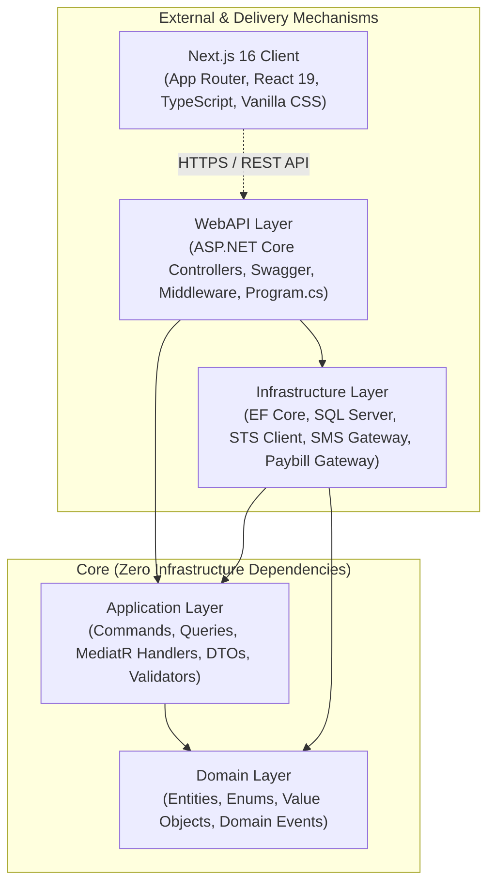
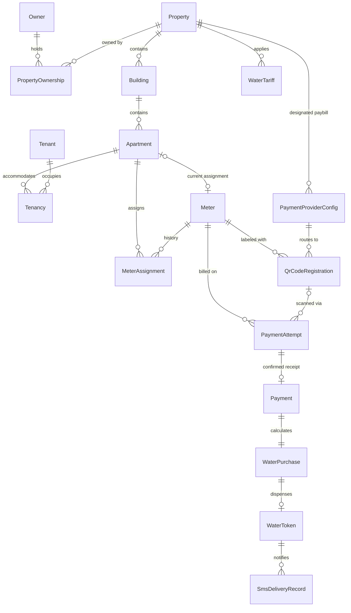

# Maji Ledger — Architecture & System Design

## 1. Architectural Philosophy: Clean Architecture

Maji Ledger is built following the principles of **Clean Architecture** (Uncle Bob), ensuring the core business and domain rules are strictly decoupled from external technologies, frameworks, user interfaces, and databases.



### Layer Responsibilities

| Layer | Project | Responsibilities & Constraints |
| :--- | :--- | :--- |
| **Domain** | `MajiLedger.Domain` | Enterprise business entities, domain enums, auditable entity base classes. **Zero external NuGet dependencies** (pure .NET standard types). Entities encapsulate domain state modifications via explicit domain methods. |
| **Application** | `MajiLedger.Application` | Use cases, CQRS commands/queries via MediatR, FluentValidation pipelines, interfaces for external services (`IApplicationDbContext`, `IStsTokenService`, `IPaymentGatewayService`, `ISmsGatewayService`, `IQrCodeGeneratorService`). |
| **Infrastructure** | `MajiLedger.Infrastructure` | EF Core `DbContext` implementation, entity type configurations, SQL Server persistence, implementations of external provider gateways (Daraja M-Pesa, STS Token Key Management, Africa's Talking / Twilio SMS, QRCoder). |
| **WebAPI** | `MajiLedger.WebAPI` | HTTP API presentation layer, attribute routing (`api/v1/...`), OpenAPI / Swagger specification, centralized exception handling middleware, CORS policies. |
| **Frontend** | `Frontend/src` | Public Scan to Pay customer web app (`/pay/[token]`), Administrator dashboard (`/dashboard`), QR Analytics portal (`/dashboard/qr-analytics`), Property Owner portal (`/dashboard/owner`). |

---

## 2. Backend Project Structure

```text
Backend/
├── Domain/
│   ├── Common/
│   │   ├── AuditableEntity.cs       # CreatedAt, CreatedBy, UpdatedAt, UpdatedBy, IsDeleted
│   │   └── BaseEntity.cs            # Primary key GUID generation
│   ├── Entities/
│   │   ├── Apartment.cs             # Unit / flat within a building
│   │   ├── ApplicationUser.cs       # Platform user with UserRole
│   │   ├── Building.cs              # Block / wing within a property
│   │   ├── Meter.cs                 # Water meter device (Prepaid STS, Standard, Smart)
│   │   ├── MeterAssignment.cs       # Historical record of meter-to-apartment assignments
│   │   ├── MeterReading.cs          # Reading logs for standard/smart meters
│   │   ├── Owner.cs                 # Property owner / landlord identity
│   │   ├── Payment.cs               # Confirmed financial payment receipt (ProviderRef unique)
│   │   ├── PaymentAttempt.cs        # One row per initiation (Initiated, Confirmed, Failed, Expired)
│   │   ├── PaymentProviderConfig.cs # Paybill / shortcode non-secret routing metadata
│   │   ├── Property.cs              # Real estate property / estate
│   │   ├── PropertyAccess.cs        # Staff / manager permission grants
│   │   ├── PropertyOwnership.cs     # Link between Owner and Property (Primary/Co-Owner)
│   │   ├── QrCodeAuditLog.cs        # Audit trail for QR code state transitions
│   │   ├── QrCodeRegistration.cs    # Authoritative meter-to-Paybill QR registration
│   │   ├── SharedMeterBillingPoint.cs # Multi-apartment shared meter apportionment
│   │   ├── SmsDeliveryRecord.cs     # Outbound SMS token dispatch records
│   │   ├── TariffTier.cs            # Stepped pricing tiers (volume blocks)
│   │   ├── Tenancy.cs               # Tenant lease agreement on an apartment
│   │   ├── Tenant.cs                # Tenant customer identity
│   │   ├── TokenGenerationAttempt.cs # Audit logs of STS dispenser requests and responses
│   │   ├── TransactionAuditLog.cs   # Financial reconciliation and mutation audits
│   │   ├── WaterPurchase.cs         # Bridges Payment to water units and STS token
│   │   ├── WaterTariff.cs           # Flat or tiered tariff schedule
│   │   └── WaterToken.cs            # 20-digit STS prepaid token record
│   └── Enums/
│       └── DomainEnums.cs           # All domain enums (MeterType, QrCodeStatus, PaymentChannel, etc.)
├── Application/
│   ├── Common/
│   │   ├── Exceptions/              # NotFoundException, ConflictException, ForbiddenException, ValidationException
│   │   ├── Interfaces/              # IApplicationDbContext, IPaymentGatewayService, IStsTokenService, etc.
│   │   └── Validators/              # FluentValidation validators
│   ├── Features/
│   │   ├── Dashboard/               # AdminDashboard, OwnerDashboard, QrAnalytics queries & handlers
│   │   ├── Meters/                  # Meter CRUD, assignment, queries
│   │   ├── Owners/                  # Owner registration, property ownership assignment
│   │   ├── PaymentConfigs/          # PaymentProviderConfig management
│   │   ├── Payments/                # ScanToPay landing, InitiatePayment, Callback confirmation, Paybill reconciliation
│   │   ├── Properties/              # Property, Building, Apartment management
│   │   ├── QrCodes/                 # Register QR, Disable, Revoke, Sticker generation
│   │   ├── Tariffs/                 # Tariff schedule management
│   │   ├── Tenants/                 # Tenant registration and tenancy lifecycle
│   │   └── Tokens/                  # Token retrieval and regeneration
│   └── Services/
│       ├── IPaymentFulfillmentService.cs
│       ├── PaymentFulfillmentService.cs # Idempotent callback processing, tariff execution, STS & SMS dispatch
│       └── TariffCalculatorService.cs   # Stepped volume and flat tariff computation engine
├── Infrastructure/
│   ├── Persistence/
│   │   ├── Configurations/          # EF Core Fluent API entity configurations
│   │   └── MajiLedgerDbContext.cs   # EF Core DbContext implementing IApplicationDbContext
│   └── Services/
│       ├── PaymentGatewayService.cs # M-Pesa Daraja STK Push / C2B integration
│       ├── QrCodeGeneratorService.cs# SVG & Base64 PNG QR code generator
│       ├── SmsGatewayService.cs     # Africa's Talking / Twilio SMS provider integration
│       └── StsTokenService.cs       # STS 20-digit key generation integration
└── WebAPI/
    ├── Controllers/                 # REST controllers (Meters, Payments, Properties, QrCodes, Dashboard, etc.)
    └── Program.cs                   # Host setup, middleware pipeline, DI registrations
```

---

## 3. Database Schema & Entity Relationships

The relational model enforces strict referential integrity and prevents orphaned records through non-destructive soft-delete patterns:



### Relational Integrity Rules
1. **Physical Traceability**: `Meter` denormalizes `CurrentApartmentId` for fast index lookups, while full assignment history is immutably maintained in `MeterAssignments`.
2. **ProviderRef Uniqueness**: `Payment.ProviderRef` has a unique database index. Duplicate payment webhooks are discarded idempotently without duplicating water purchases or STS tokens.
3. **Public Token Uniqueness**: `QrCodeRegistration.PublicToken` is a cryptographically unique 32-character string.
4. **Single Active QR per Meter**: A filtered unique database index ensures only one `Active` QR code registration can exist per meter at any given time (`[Status] = 'Active'`).

---

## 4. Next.js Frontend Architecture

Built on **Next.js 16 (App Router)**, **React 19**, **TypeScript**, and **Vanilla CSS Design System**:

```text
Frontend/src/
├── app/
│   ├── globals.css                  # Design tokens, variables, typography, glassmorphism styles
│   ├── layout.tsx                   # Root layout, HTML meta, Google Fonts
│   ├── page.tsx                     # Public landing page with Scan to Pay test scanner
│   ├── pay/
│   │   └── [token]/
│   │       ├── page.tsx             # Public Scan to Pay customer landing page
│   │       └── ScanToPayClient.tsx  # Verified destination display, KES input, STK prompt & live polling
│   └── dashboard/
│       ├── layout.tsx               # Dashboard shell with persistent sidebar navigation
│       ├── page.tsx                 # Administrator portfolio overview route
│       ├── DashboardOverviewClient.tsx # Live KPI stat cards, channel breakdown, operational health
│       ├── qr-analytics/
│       │   ├── page.tsx             # QR deployment traceability route
│       │   └── QrAnalyticsClient.tsx# Filterable table, drill-down modal, CSV export
│       ├── owner/
│       │   ├── page.tsx             # Property Owner Portal route
│       │   └── OwnerDashboardClient.tsx # Owner switcher, isolated property metrics, statement CSV export
│       ├── properties/
│       │   ├── page.tsx             # Property management route
│       │   └── PropertiesClient.tsx # Hierarchy viewer (Property -> Building -> Unit)
│       ├── meters/
│       │   ├── page.tsx             # Water meter registry route
│       │   └── MetersClient.tsx     # Meters table, assignment status, QR sticker viewer
│       └── payments/
│           ├── page.tsx             # Transactions ledger route
│           └── PaymentsClient.tsx   # All payment attempts, STS tokens, SMS statuses
├── components/
│   ├── layout/
│   │   └── DashboardSidebar.tsx     # Persistent navigation sidebar with active link indicators
│   └── ui/
│       ├── Badges.tsx               # StatusBadge, ChannelBadge, MeterTypeBadge
│       ├── FeatureCard.tsx          # Marketing feature card
│       ├── Modal.tsx                # Generic accessible modal dialog
│       └── StatCard.tsx             # Metric KPI card with trend indicator
├── lib/
│   └── api/
│       ├── client.ts                # Centralized typed HTTP client with error handling
│       └── health.ts                # Backend connectivity health probe
└── types/
    └── domain.ts                    # Shared TypeScript interfaces mirroring backend DTOs
```

---

## 5. Security & Isolation Model

### 1. Zero Trust on Client Inputs
During Scan to Pay, the client only submits `(PublicToken, CustomerPhone, Amount)`. The server looks up the QR registration in the database to resolve the real `MeterId`, `PropertyId`, and `PaymentProviderConfigId`. A client cannot modify the meter number or route money to a different Paybill.

### 2. Multi-Tenant Data Isolation
Every owner query is scoped strictly to authorized properties using the `PropertyOwnership` entity:
```csharp
var authorizedPropertyIds = await db.PropertyOwnerships
    .Where(po => po.OwnerId == request.OwnerId && po.EffectiveTo == null)
    .Select(po => po.PropertyId)
    .ToListAsync(ct);
```
Attempts by owners to access meters, collections, or QR codes of other properties result in an immediate `403 Forbidden` response.
