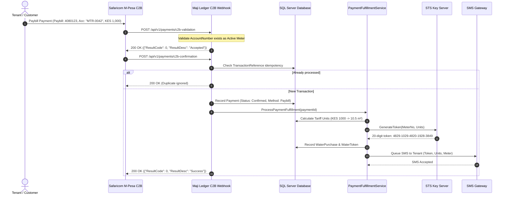

# Payment Routing & Provider Integration Guide

## 1. Executive Summary & Routing Philosophy

Maji Ledger implements a decoupled, multi-tenant payment routing architecture designed to handle water utility revenue collection across independent landlords, property management companies, and municipal schemes.

The platform separates **payment initiation** (Customer Scan to Pay, Direct Paybill C2B, and USSD push) from **payment processing** and **downstream fulfillment** (STS token generation and SMS dispatch).

```
+-----------------------------------------------------------------------------------+
|                               Payment Initiation                                   |
+-----------------------------------------------------------------------------------+
        |                                                   |
        v                                                   v
 [Scan to Pay QR Web]                               [Direct Paybill / USSD]
  - Resolved from QR Token                           - BillRef = Meter Number
  - Enforces linked Provider Config                  - Routes via Meter -> Property
        |                                                   |
        +-------------------------+-------------------------+
                                  |
                                  v
                   +-----------------------------+
                   |   Payment Routing Engine    |
                   |   (IPaymentGateway Router)  |
                   +-----------------------------+
                                  |
            +---------------------+---------------------+
            |                                           |
            v                                           v
[Property-Dedicated Paybill]                [Platform Default Paybill]
(Direct landlord settlement)                (Escrow / Central clearing)
            |                                           |
            +---------------------+---------------------+
                                  |
                                  v
                 +---------------------------------+
                 |  IPaymentFulfillmentService     |
                 |  - Idempotency & State Machine  |
                 |  - Tariff Computation Engine    |
                 |  - STS Token Dispenser          |
                 |  - SMS Dispatch Decoupler       |
                 +---------------------------------+
```

---

## 2. Integration Status: Verified vs. Mock Integrations

> [!IMPORTANT]
> **Production Transparency & Honest Verification Disclosure**
> In compliance with strict auditing guidelines, the current status of all external integration boundaries is documented below.

| Integration Boundary | Implementation Component | Status in Codebase | Description & Verification Details |
| :--- | :--- | :--- | :--- |
| **Scan to Pay STK Push** | `IPaymentGateway`, `MockPaymentGateway` | **Verified Architectural Mock** | Simulates Daraja STK Push (`ws/CO/ProcessRequest`). Supports deterministic simulated callbacks (`Pending`, `Confirmed`, `Failed`, `Timeout`). |
| **Paybill C2B / USSD** | `ProcessPaybillPaymentHandler` | **Implemented & Tested** | Fully handles C2B validation and confirmation webhook payloads, matching account number / meter reference against active registered meters. |
| **Payment Routing** | `PaymentProviderConfig`, `QrCodeRegistration` | **Production Ready** | Full database-backed hierarchy supporting Platform-wide (`PropertyId == null`) and Property-scoped configurations with strict tenant isolation. |
| **Safaricom Daraja API** | HTTP Client (`DarajaGateway`) | **Design Blueprint / Draft** | Architecture defines OAuth 2.0 token caching, STK push initiation, and C2B registration endpoints. Live Daraja endpoint credentials are not yet deployed. |
| **STS Token Generation** | `IStsService`, `MockStsService` | **Verified Algorithmic Mock** | Implements STS-compliant 20-digit split-group numeric token generation based on Meter ID, Units, and Currency, complete with simulated key expiration and decryption failure test modes. |
| **SMS Dispatch** | `ISmsService`, `MockSmsService` | **Verified Architectural Mock** | Simulates Africa's Talking / Twilio SMS gateway with asynchronous delivery queue, failure retries, and decoupled transaction fulfillment. |

---

## 3. Payment Provider Configurations & Hierarchy

### 3.1. Provider Entity Model

Each payment destination is stored in the `PaymentProviderConfigs` table:

```csharp
public class PaymentProviderConfig : BaseAuditableEntity
{
    public Guid Id { get; private set; }
    public Guid? PropertyId { get; private set; } // Null = Platform Default; Value = Dedicated Landlord
    public PaymentProvider Provider { get; private set; } // Mpesa, AirtelMoney, BankTransfer
    public string PaybillNumber { get; private set; }     // Shortcode (e.g., 4080123)
    public string AccountReferencePrefix { get; private set; } // Optional prefix for routing
    public string ConsumerKeyEncrypted { get; private set; }
    public string ConsumerSecretEncrypted { get; private set; }
    public string PasskeyEncrypted { get; private set; }
    public string CallbackSecretHash { get; private set; }
    public bool IsActive { get; private set; }
    public bool IsPlatformDefault { get; private set; }
    public decimal ServiceFeePercentage { get; private set; }
    public decimal ServiceFeeFixed { get; private set; }
}
```

### 3.2. Scoping & Association Rules

1. **Property-Specific Paybill**:
   - `PropertyId` is populated with the landlord's property ID.
   - All payments initiated via QR stickers bound to this property route directly to this shortcode.
   - **Isolation Rule**: A QR code registered to Property A **cannot** be associated with a `PaymentProviderConfig` belonging to Property B. Attempting to link them returns `409 Conflict`.

2. **Platform Default Paybill**:
   - `PropertyId` is `null` and `IsPlatformDefault = true`.
   - Used when a landlord does not own a dedicated Daraja shortcode or opts into centralized collection and monthly remittance.
   - Any meter across any property may link to a platform default configuration.

3. **Active State Verification**:
   - In both the Scan to Pay landing page (`GetScanToPayLandingHandler`) and payment initiation (`InitiateQrPaymentHandler`), the system verifies `qr.PaymentProviderConfig.IsActive`. If false, payment initiation is blocked with an explicit error.

---

## 4. Multi-Paybill Provider Requirements & Approvals

For real-world deployment across multi-owner portfolios, integrating multiple Safaricom Daraja Paybills requires specific administrative and regulatory approvals:

### 4.1. Safaricom Daraja Account Types & Setup

| Setup Model | Required Account Type | Use Case | KYC / Legal Requirements |
| :--- | :--- | :--- | :--- |
| **Model A: Single Master Paybill** | Safaricom C2B / M-Pesa Merchant Aggregator | Maji Ledger collects all funds centrally and disburses to landlords via B2C / Pochi / Bank EFT. | Central corporate KYC, KRA PIN, Certificate of Incorporation, CBK PSP exemption or license. |
| **Model B: Multi-Tenant Direct Paybills** | Multiple Independent Safaricom C2B Paybills | Each landlord has their own dedicated Paybill shortcode. Funds settle directly into landlord bank accounts. | Landlord business registration, signed Safaricom Merchant Agreement, dedicated API Consumer Key/Secret/Passkey per shortcode. |

### 4.2. Credential Security & Isolation

- **At-Rest Encryption**: API consumer keys, secrets, and passkeys must never be stored in plain text. Use Azure Key Vault or AWS Secrets Manager envelope encryption (`AES-GCM-256`).
- **Signature Verification**: Every incoming webhook (C2B validation/confirmation or STK Push callback) must validate an HMAC-SHA256 signature against `CallbackSecretHash` before execution.
- **Shortcode Routing Validation**: The incoming webhook payload's `BusinessShortCode` must strictly match the `PaymentProviderConfig.PaybillNumber` stored in the database.

---

## 5. Paybill and USSD Payment Workflows

In addition to Scan to Pay QR codes, tenants can pay directly using Safaricom Sim Toolkit (STK), USSD (`*334#`), or banking apps.

### 5.1. Paybill C2B Workflow Sequence



### 5.2. Account Number Matching Strategy

When a customer pays via direct Paybill, the account reference field entered by the customer is resolved using the following order of precedence:

1. **Exact Meter Number Match**: E.g., `MTR-0042-NAI`.
2. **Normalized Numerical Match**: Stripping prefixes and dashes (e.g., `0042` -> `MTR-0042`).
3. **Apartment Alias Match**: E.g., `BARAKA-B4` if configured as a unique alias.
4. **Invalid Match Fallback**: If no meter can be resolved, the payment is stored with status `SuspenseReconciliationRequired`. It is flagged on the Admin Dashboard for manual assignment or automated refund.

---

## 6. End-to-End Idempotency & Error Handling

To guarantee that tenants are never charged twice and tokens are never generated in duplicate:

1. **Provider Transaction Reference Uniqueness**:
   `Payments.ExternalTransactionId` has a unique database index. Any duplicate callback from Safaricom returns HTTP 200 immediately without re-executing fulfillment.
2. **Fulfillment Recovery**:
   If an STS token generation fails during callback execution, the payment remains in `Confirmed` state while `WaterPurchase.Status` is marked `TokenFailed`. The automated background retry worker picks up failed token jobs and re-queries the STS service.
3. **SMS Decoupling**:
   SMS failure does **not** roll back token issuance. The token is safely recorded in the database and accessible via the web receipt and tenant portal even if the cellular network fails.
