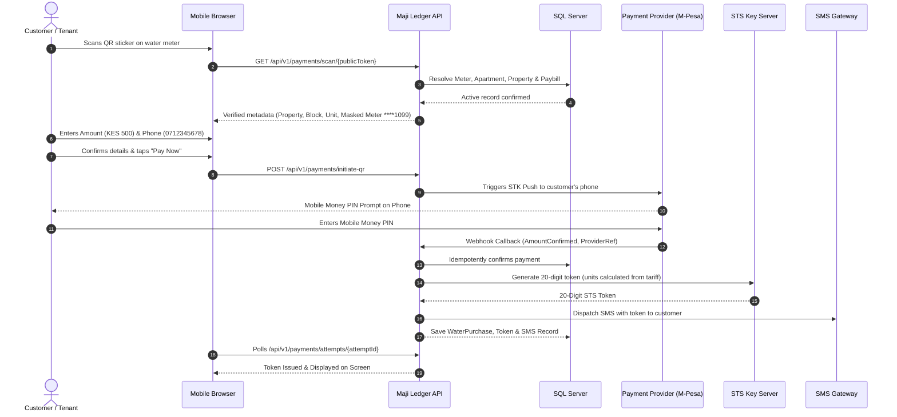
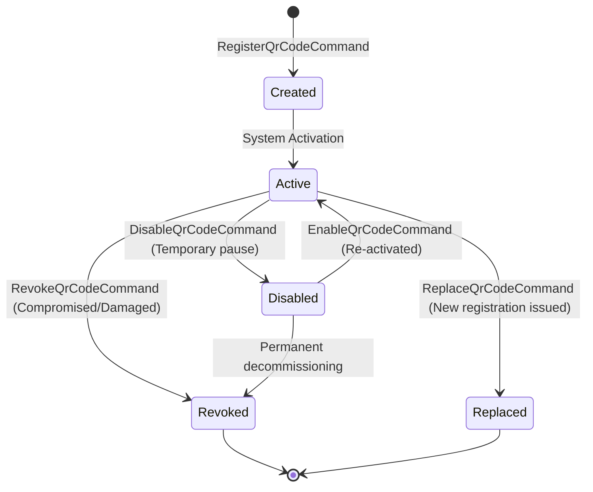

# Maji Ledger — Scan to Pay & QR-Code Lifecycle

## 1. Overview & Security Foundation

Maji Ledger's **Scan to Pay** workflow allows tenants and consumers to scan a physical QR sticker attached to their water meter with any mobile phone camera, open a secure verification checkout page, and pay via mobile money (M-Pesa STK Push / Airtel Money).

### Security Architecture of the QR Code
- The physical QR code sticker **only contains a public URL**:
  `https://pay.majiledger.com/p/{PublicToken}`
- **No credentials, no meter serial numbers, no Paybill secrets, and no account keys are embedded in the QR image.**
- The `PublicToken` is an opaque, URL-safe, cryptographically random 32-character string.
- All routing and verification occur strictly on the backend via database resolution.



---

## 2. The Complete QR-Code Lifecycle

Every meter sticker goes through an audited, multi-stage lifecycle managed through `QrCodesController` and domain audit logs (`QrCodeAuditLog`):



### Stage 1: Registration & Validation Preview
Before issuing a physical sticker, an administrator or property manager invokes the preview endpoint:
```http
GET /api/v1/qr-codes/preview?meterId={meterId}&paymentProviderConfigId={configId}
```
The server validates:
1. Meter exists, is in `Active` status, and is currently assigned to a valid apartment.
2. The selected `PaymentProviderConfig` is active and approved.
3. If the payment provider configuration is property-scoped, it matches the property where the meter is physically located.
4. Returns a preview DTO showing the location chain (`Property` &rarr; `Building` &rarr; `Apartment` &rarr; `Meter`) and validation status.

### Stage 2: Registration & Activation
The administrator executes:
```http
POST /api/v1/qr-codes/register
{
  "meterId": "3fa85f64-5717-4562-b3fc-2c963f66afa6",
  "paymentProviderConfigId": "4ba85f64-5717-4562-b3fc-2c963f66afa7",
  "registeredBy": "admin@majiledger.com"
}
```
- A new `QrCodeRegistration` is saved with `QrCodeStatus.Active`.
- A unique index enforces that **only one Active registration can exist for a meter at any time**.
- An audit entry (`QrCodeAuditEvent.Created`) is immutably logged with the author's identity and timestamp.

### Stage 3: Sticker Generation & Printing Guidelines
The sticker layout is retrieved via:
```http
GET /api/v1/qr-codes/{registrationId}/sticker
```
The endpoint returns:
- Vector SVG string (`qrCodeSvg`) for high-resolution industrial printing.
- Base64 Data URI (`qrCodeDataUri`) for web preview.
- Masked meter identifier (`****1099`), Property Name, Building, and Unit Number.

#### Industrial Print Specifications
- **Material**: Heavy-duty matte polyester or synthetic vinyl with UV-resistant laminate.
- **Adhesive**: High-tack permanent acrylic adhesive suitable for plastic/metal meter casings.
- **Tamper Evidence**: Destructible vinyl that shreds upon peeling to prevent unauthorized transfer.
- **Dimensions**: Standard 60mm &times; 60mm or 75mm &times; 75mm with high-contrast black on white.

### Stage 4: Physical Verification & Field Auditing
Field technicians verify stickers using the QR Analytics scanner in the mobile dashboard (`/dashboard/qr-analytics`):
1. Scan the installed physical sticker.
2. Verify that the displayed Apartment Number and Masked Meter Number match the physical water meter's engraved metal nameplate and unit door.
3. Mark physical verification complete in the property management ledger.

### Stage 5: Temporary Disabling
If an apartment is vacant, undergoes plumbing repairs, or tenancy is disputed:
```http
POST /api/v1/qr-codes/{registrationId}/disable
{
  "disabledBy": "property.manager@majiledger.com"
}
```
- Status transitions to `QrCodeStatus.Disabled`.
- Any customer scanning the code receives a clear message:
  *"This QR code has been temporarily disabled by property management. Please contact the property manager."*
- Payment initiation is blocked on the server.
- The registration can be re-enabled at any time using `/enable`.

### Stage 6: Replacement (Damaged Sticker)
If a physical QR sticker becomes scratched, faded, or weathered:
```http
POST /api/v1/qr-codes/{meterId}/replace
{
  "meterId": "3fa85f64-5717-4562-b3fc-2c963f66afa6",
  "paymentProviderConfigId": "4ba85f64-5717-4562-b3fc-2c963f66afa7",
  "reason": "Physical sticker degraded by direct sunlight",
  "replacedBy": "field.tech@majiledger.com"
}
```
1. The existing active QR code is automatically moved to `Revoked` status.
2. A new `QrCodeRegistration` is created with a fresh `PublicToken`.
3. An audit record `QrCodeAuditEvent.Replaced` links the old registration ID to the new one.
4. Old sticker scans will immediately fail; only the newly printed sticker can be used.

### Stage 7: Permanent Revocation
If a meter is decommissioned, compromised, or stolen:
```http
POST /api/v1/qr-codes/{registrationId}/revoke
{
  "reason": "Meter removed from service and replaced with bulk smart meter",
  "revokedBy": "admin@majiledger.com"
}
```
- Status transitions to `QrCodeStatus.Revoked`.
- Audit event `QrCodeAuditEvent.Revoked` is recorded.
- The revocation is irreversible.

---

## 3. Physical Sticker Displacement: Threat Analysis & Mitigations

> [!WARNING]
> ### Known Physical Vulnerability
> While the backend guarantees that a given `PublicToken` routes payment to its registered meter and property, **the software cannot physically prevent a bad actor from peeling a sticker off Meter A and placing it on Meter B**.

### Three-Layer Defense Strategy

1. **Tamper-Evident Substrates**:
   Stickers must be printed on destructible vinyl or "VOID" tamper-evident security film. Any attempt to peel the sticker causes it to fragment into unreadable pieces.
2. **Mandatory Display of Apartment and Masked Meter Identifier**:
   The Scan to Pay page deliberately displays:
   - Estate / Property Name (e.g., *Savannah Palms Estate*)
   - Building / Block (e.g., *Palm Block 1*)
   - Apartment / House Number (e.g., *Unit 2A*)
   - Masked Meter Number (e.g., `****1099`)
   Tenants are explicitly warned on the UI: *"Verify that the unit number and meter above match your apartment before confirming payment."*
3. **QR Traceability Audits**:
   Property managers use the QR Analytics dashboard (`/dashboard/qr-analytics`) to monitor conversion anomalies. If a sticker suddenly records zero transactions or transactions from unexpected phone numbers, an automated alert flags the unit for physical inspection.
