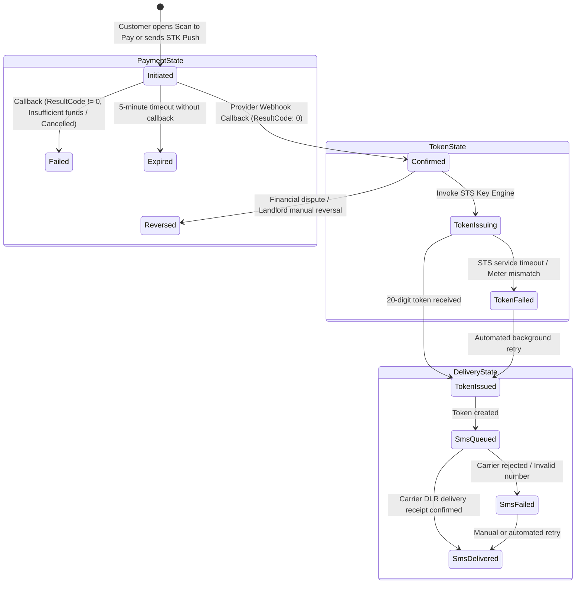

# Tariffs, STS Token Generation & SMS Fulfillment Guide

## 1. Overview

The Maji Ledger fulfillment pipeline converts confirmed financial transactions into cryptographically signed STS (Standard Transfer Specification) prepaid water credit tokens and dispatches them to tenants via SMS and web interfaces.

```
+-----------------------------------------------------------------------------------------+
|                                Transaction Confirmed                                    |
|                       (ExternalTransactionId, Amount: KES)                              |
+-----------------------------------------------------------------------------------------+
                                           |
                                           v
                   +-----------------------------------------------+
                   |           1. Tariff Calculation Engine        |
                   |   - Deduct fixed standing charges             |
                   |   - Compute consumption volume across tiers   |
                   |   - Calculate taxes / municipal levies        |
                   +-----------------------------------------------+
                                           |
                                           v
                   +-----------------------------------------------+
                   |           2. STS Vending Engine (IEC 62055)   |
                   |   - Validate Meter DRRN & Tariff Index        |
                   |   - Generate 20-Digit Encrypted Token (TID)   |
                   |   - Record Token Class & Expiry Data          |
                   +-----------------------------------------------+
                                           |
                                           v
                   +-----------------------------------------------+
                   |           3. Decoupled SMS Notification       |
                   |   - Normalize Phone to E.164 (+254...)        |
                   |   - Queue SMS Dispatch                        |
                   |   - Async Gateway Delivery & Status Tracking  |
                   +-----------------------------------------------+
```

---

## 2. Tariff Engine & Water Unit Calculation

### 2.1. Domain Entities & Configuration

Water tariffs are defined per property or municipal utility schema using the `Tariff` and `TariffTier` entities:

```csharp
public class Tariff : BaseAuditableEntity
{
    public Guid Id { get; private set; }
    public Guid PropertyId { get; private set; }
    public string Name { get; private set; }               // e.g., "Nairobi Residential Stepped"
    public TariffType Type { get; private set; }           // FlatRate, TieredStepped, Lifeline
    public decimal StandingCharge { get; private set; }    // Monthly fixed service charge (KES)
    public decimal MinimumRechargeAmount { get; private set; } // e.g., KES 50.00
    public decimal VatRate { get; private set; }           // e.g., 0.16 (16%)
    public decimal SanitationLevyRate { get; private set; }// e.g., 0.05 (5%)
    public ICollection<TariffTier> Tiers { get; private set; }
}
```

### 2.2. Tiered (Stepped) Tariff Computation Algorithm

In stepped tariffs (recommended by water services regulatory boards), water consumption is divided into blocks with progressive pricing to encourage conservation:

| Tier | Consumption Block ($m^3$) | Rate per $m^3$ (KES) | Purpose |
| :--- | :--- | :--- | :--- |
| **Tier 1 (Lifeline)** | $0.00 - 6.00$ | KES 65.00 | Basic domestic subsistence |
| **Tier 2 (Standard)** | $6.01 - 20.00$ | KES 95.00 | Average household consumption |
| **Tier 3 (High)** | $20.01 - 50.00$ | KES 140.00 | High domestic / small commercial |
| **Tier 4 (Excessive)**| $> 50.00$ | KES 200.00 | Swimming pools, luxury irrigation |

#### Computation Formula:
$$\text{Net Amount} = \frac{\text{Gross Payment} - \text{Standing Charge}}{1 + \text{VAT Rate} + \text{Sanitation Levy Rate}}$$

The algorithm iteratively allocates the net amount across available tiers until the remaining balance reaches zero:

```csharp
public TariffCalculationResult CalculateUnits(Tariff tariff, decimal paymentAmount, decimal priorMonthConsumption = 0)
{
    if (paymentAmount < tariff.MinimumRechargeAmount)
        throw new InvalidOperationException($"Amount is below minimum recharge of KES {tariff.MinimumRechargeAmount}");

    decimal taxMultiplier = 1.0m + tariff.VatRate + tariff.SanitationLevyRate;
    decimal netWaterAmount = (paymentAmount - tariff.StandingCharge) / taxMultiplier;
    
    decimal remainingBalance = netWaterAmount;
    decimal totalUnits = 0.0m;

    foreach (var tier in tariff.Tiers.OrderBy(t => t.TierOrder))
    {
        decimal tierCapacity = tier.UpperLimitM3 - tier.LowerLimitM3;
        decimal tierCost = tierCapacity * tier.RatePerM3;

        if (remainingBalance >= tierCost)
        {
            totalUnits += tierCapacity;
            remainingBalance -= tierCost;
        }
        else
        {
            totalUnits += (remainingBalance / tier.RatePerM3);
            remainingBalance = 0;
            break;
        }
    }

    return new TariffCalculationResult(
        UnitsPurchased: Math.Round(totalUnits, 2),
        NetWaterCost: Math.Round(netWaterAmount, 2),
        Taxes: Math.Round(paymentAmount - netWaterAmount, 2),
        StandingChargeDeducted: tariff.StandingCharge
    );
}
```

---

## 3. STS (Standard Transfer Specification) API Integration

Maji Ledger integrates with STS-compliant water meters (IEC 62055-41, IEC 62055-51) via the `IStsService` interface.

### 3.1. Standard Transfer Specification Architecture

- **Token Format**: 20 decimal digits split into five 4-digit groups (e.g., `5182-9402-1849-0192-4820`).
- **Token Identifier (TID)**: A 24-bit timestamp relative to the base date (1993-01-01), preventing token replay attacks.
- **Supply Group Code (SGC)**: Identifies the vending entity/utility key.
- **Tariff Index (TI)**: Specifies the meter's active tariff table.
- **Key Revision Number (KRN)**: Incremented during Key Change Tokens (KCT).

### 3.2. Integration Boundary Contract

```csharp
public interface IStsService
{
    Task<StsTokenResponse> GenerateCreditTokenAsync(StsTokenRequest request, CancellationToken cancellationToken);
    Task<StsKeyChangeResponse> GenerateKeyChangeTokensAsync(StsKeyChangeRequest request, CancellationToken cancellationToken);
    Task<bool> VerifyMeterCompatibilityAsync(string meterNumber, CancellationToken cancellationToken);
}

public record StsTokenRequest(
    string MeterNumber,
    decimal UnitsPurchased,
    decimal MonetaryAmount,
    string TransactionReference,
    int TariffIndex = 1
);

public record StsTokenResponse(
    bool Success,
    string FormattedToken,     // 20-digit formatted token: "XXXX-XXXX-XXXX-XXXX-XXXX"
    string RawToken,           // 20-digit continuous string
    int TokenIdentifier,       // TID
    string ErrorMessage = null
);
```

### 3.3. Algorithmic Mock & Live Production Boundary

- **In Development / Test**: `MockStsService` deterministically generates STS 20-digit numeric codes with a valid Luhn-variant checksum and simulated TID increments.
- **In Live Production**: `ProductionStsClient` communicates with a dedicated Hardware Security Module (HSM) or cloud STS Key Server (e.g., Landis+Gyr, Hexing, Conlog, or Kamstrup STS KMS) over mutual TLS (mTLS) with client certificate authentication.

---

## 4. Decoupled SMS Token Delivery

To prevent mobile network latency or carrier downtimes from degrading the customer payment experience, SMS dispatch is fully decoupled from transaction confirmation.

### 4.1. SMS Notification Template

```text
Maji Ledger: Token for Meter {MeterNumber} (Apt {Apartment}):
Token: {FormattedToken}
Units: {Units} m3 | Paid: KES {Amount:N2} | Ref: {PaymentReference}
Enter 20 digits on meter keypad and press '#'.
Customer Care: 0700-000-000
```

### 4.2. Delivery Workflow & Phone Number Normalization

1. **E.164 Standardization**:
   Phone numbers from various formats (`0712345678`, `254712345678`, `+254 712 345 678`) are automatically normalized to `+2547XXXXXXXX`.
2. **Asynchronous Queue**:
   The `SmsDeliveryRecord` entity is created with status `Queued`. An asynchronous background worker (`SmsDispatcherWorker`) batches unsent messages and submits them to the SMS gateway (Africa's Talking / Twilio).
3. **Resilience**:
   If SMS dispatch fails (e.g., carrier timeout or invalid subscriber), `SmsDeliveryRecord` status updates to `Failed`, and retry counts are incremented. The token remains valid and visible on the user's web receipt at all times.

---

## 5. Transaction Statuses & Reconciliation State Machine

Transactions undergo rigorous status tracking across their financial, utility, and messaging lifecycles.



### 5.1. Transaction Status Matrix

| Component | Status | Meaning | Recovery / Next Action |
| :--- | :--- | :--- | :--- |
| **Payment** | `Initiated` | STK push sent; awaiting customer PIN. | Polling timer checks for 120 seconds. |
| **Payment** | `Confirmed` | Money debited from customer wallet; credited to Paybill. | Triggers token generation immediately. |
| **Payment** | `Failed` | User cancelled, wrong PIN, or insufficient balance. | Terminal state; customer notified to retry. |
| **Payment** | `Expired` | No callback received within provider timeout window. | Automatically marked expired by background sweeper. |
| **WaterPurchase** | `TokenIssued` | STS token successfully minted and cryptographically signed. | Immediate persistence and queueing of SMS. |
| **WaterPurchase** | `TokenFailed` | STS HSM offline or communication error. | Flagged on Admin Dashboard; automatic retry worker attempts replay. |
| **SmsDelivery** | `Delivered` | Delivery receipt confirmed by telecom operator. | Terminal success. |
| **SmsDelivery** | `Failed` | Telecom delivery failed (e.g., out of coverage). | Token remains accessible via web receipt URL (`/pay/[qrId]`). |

### 5.2. Automated Reconciliation & Discrepancy Auditing

A nightly reconciliation worker compares:
1. **M-Pesa Statement Records** (from Safaricom Statement API / SFTP export).
2. **Maji Ledger Payment Records** (`Payments` table).
3. **STS Token Generation Logs**.

Discrepancies (such as unfulfilled payments or duplicate provider callbacks) are routed to the **Suspense & Reconciliation Queue** on the Administrator Dashboard for one-click manual token regeneration or refund processing.
